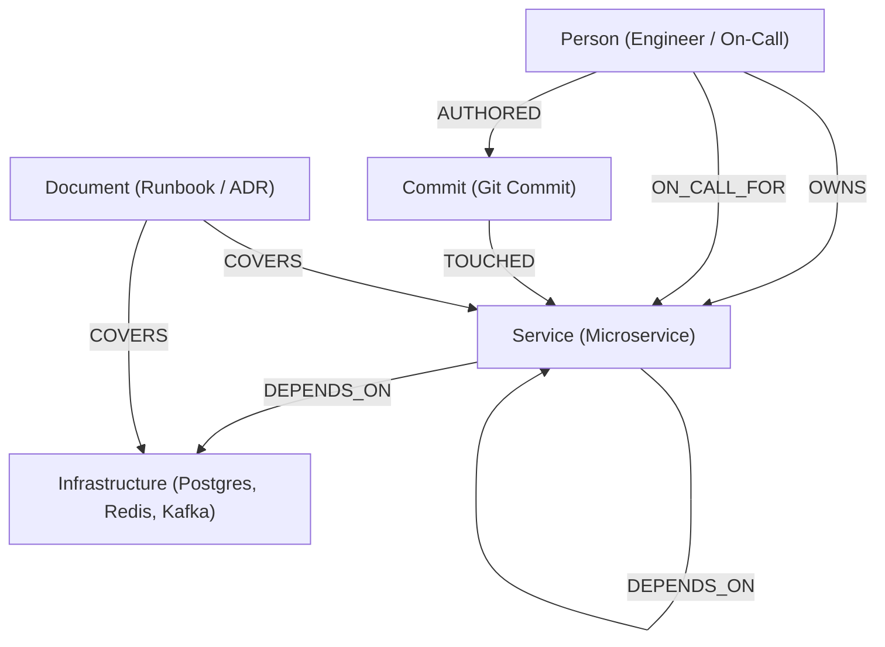
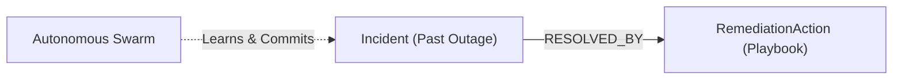

# 🌌 NexusOps: Autonomous Incident Commander & Enterprise Knowledge Brain
### Built with FalkorDB for Graph Hacks 2026 (WeMakeDevs & FalkorDB)

[](https://falkordb.com/)
[](#track-1-agents-that-act-on-connected-data)
[](#track-2-agent-memory-and-coordination)
[](#track-3-company-brain)
[](https://fastapi.tiangolo.com/)
[](https://js.cytoscape.org/)

---

## 💡 Executive Summary & The Vision

When a critical production outage strikes, traditional LLM agents flounder because **they lack topological context**:
- They see single alert strings without understanding multi-hop service dependencies.
- They lack persistent episodic memory of prior resolved incidents.
- They have no company knowledge of which engineer authored the suspect commit, who is currently on-call, or what architectural decision record (ADR) governs the system.

**NexusOps** solves this by placing **FalkorDB at the heart of multi-agent incident management**. Instead of relying on brute-force vector search or unstructured context windows, NexusOps equips autonomous agents with typed Cypher graph traversals, shortest-path causality analysis, PageRank single-point-of-failure detection, and dynamic episodic memory persistence across sessions.

---

## 🏆 Hackathon Tracks Addressed (Triple-Track Architecture)

NexusOps was deliberately engineered to unify all three hackathon tracks into a cohesive, mission-critical product:

| Track | NexusOps Capability | FalkorDB Work Done |
| :--- | :--- | :--- |
| **Track 1: Agents That Act on Connected Data** | Autonomous Incident Swarm (Sentinel Triage, Root-Cause Investigator, Remediation Agent) | Traverses upstream variable-length paths `[:DEPENDS_ON*1..depth]`, executes `shortestPath()` algorithms for commit causality, and computes PageRank to detect Single Points of Failure (SPOFs). |
| **Track 2: Agent Memory & Coordination** | Multi-agent state handoffs and persistent cross-session memory | Operates multigraph topology (`nexus_incident_memory`), recalls past incidents with symptom matching, and autonomously commits newly verified playbooks back to the graph via `CREATE (i:Incident)-[:RESOLVED_BY]->(a:RemediationAction)`. |
| **Track 3: Company Brain** | Connected enterprise knowledge model | Connects microservices, databases, caches, git commits, code repositories, on-call engineers, and runbooks into one living graph (`nexus_company_brain`). |

---

## 🧬 Graph Data Model & Multigraph Topology

NexusOps leverages FalkorDB's native **multigraph topology**, hosting isolated graphs on a single instance:

### 1. `nexus_company_brain` (Track 1 & Track 3)
Connects architectural infrastructure, microservices, organizational ownership, and code changes:



### 2. `nexus_incident_memory` (Track 2: Episodic Memory)
Maintains past incidents, verified remediations, and evolving agent-generated playbooks:



---

## 🤖 The Multi-Agent Incident Swarm

When an alert triggers, four specialized agents coordinate using typed graph tools:

```
           [ Inbound Production Alert ]
                       │
                       ▼
         ┌───────────────────────────┐
         │   Sentinel Triage Agent   │  Tool: get_blast_radius()
         │  (Evaluates Blast Radius) │  Cypher: MATCH path = (s)<-[:DEPENDS_ON*1..3]-(impacted)
         └─────────────┬─────────────┘
                       │ Hand-off (Classifies Severity: P0/P1)
                       ▼
         ┌───────────────────────────┐
         │  Root-Cause Investigator  │  Tool: find_shortest_path()
         │  (Causal Path Isolation)  │  Cypher: shortestPath((service)-[*..6]-(commit))
         └─────────────┬─────────────┘
                       │ Hand-off (Isolates Suspect Commit & Author)
                       ▼
         ┌───────────────────────────┐
         │ Remediation & Comms Agent │  Tool: recall_episodic_memory() & lookup_ownership()
         │  (Playbook & Escalation)  │  Cypher: MATCH (inc)-[:RESOLVED_BY]->(act)
         └─────────────┬─────────────┘
                       │ Hand-off (Resolves & Dispatches PagerDuty Alert)
                       ▼
         ┌───────────────────────────┐
         │    Memory Coordinator     │  Tool: commit_episodic_memory()
         │  (Graph Knowledge Growth) │  Cypher: CREATE (i:Incident)-[:RESOLVED_BY]->(act)
         └───────────────────────────┘
```

1. **Sentinel Triage Agent**: Traverses upstream dependencies using variable-length paths (`*1..3`) to identify customer-facing fallout and assign severity (`P0 - CRITICAL` or `P1 - HIGH`).
2. **Root-Cause Investigator**: Executes FalkorDB shortest-path algorithms to bridge the symptom to recent git deployments, pinpointing the smoking gun commit.
3. **Remediation & Comms Agent**: Queries the `nexus_incident_memory` graph for prior matching symptoms, pulls the verified playbook, queries `nexus_company_brain` for the on-call engineer, and crafts the escalation.
4. **Memory Coordinator**: Autonomously writes the newly triaged incident and resolution back to the FalkorDB incident graph, ensuring future sessions immediately benefit from this resolution.

---

## ⚡ Core Cypher Queries & Graph Algorithms

Every action taken by NexusOps is backed by explicit, parameterized Cypher queries:

### 1. Variable-Length Blast Radius Traversal (Track 1)
```cypher
MATCH path = (s:Service {name: $service})<-[:DEPENDS_ON*1..$depth]-(impacted:Service)
RETURN impacted.name AS service, impacted.tier AS tier, length(path) AS hops,
       [n in nodes(path) | n.name] AS path_nodes
ORDER BY hops ASC
```

### 2. Shortest-Path Causality Analysis (Track 1)
```cypher
MATCH (src {name: $start}), (dst {name: $target})
MATCH p = shortestPath((src)-[*..6]-(dst))
RETURN [n in nodes(p) | n.name] AS causality_path, length(p) AS hops
```

### 3. PageRank Single-Point-of-Failure (SPOF) Analysis (Track 1)
```cypher
CALL algo.pageRank('Service', 'DEPENDS_ON') YIELD node, score
RETURN node.name AS service, score
ORDER BY score DESC
```

### 4. Company Brain Ownership & On-Call Lookup (Track 3)
```cypher
MATCH (s:Service {name: $service})<-[r:OWNS|ON_CALL_FOR]-(p:Person)
RETURN p.name AS name, p.role AS role, p.slack AS slack, p.pagerduty AS pagerduty, type(r) AS relation
```

### 5. Episodic Memory Symptom Matching (Track 2)
```cypher
MATCH (inc:Incident)-[:RESOLVED_BY]->(act:RemediationAction)
WHERE inc.symptoms CONTAINS $keyword OR inc.description CONTAINS $keyword
RETURN inc.id AS incident_id, inc.title AS title, inc.severity AS severity,
       act.action_type AS action_type, act.description AS action_desc, act.playbook_ref AS playbook_ref
```

### 6. Dynamic Knowledge Graph Memory Commit (Track 2)
```cypher
CREATE (i:Incident {id: $incident_id, title: $title, service: $service, symptoms: $symptoms})
CREATE (a:RemediationAction {id: $action_id, action_type: 'AUTONOMOUS_PLAYBOOK', description: $remediation, verified_by: $agent_name})
CREATE (i)-[:RESOLVED_BY]->(a)
```

---

## 🚀 Getting Started

NexusOps is built with a **dual-mode resilient architecture**:
- **Live FalkorDB Mode**: Connects directly to FalkorDB Cloud or a local Docker instance.
- **Embedded In-Memory Graph Simulator**: Automatically engages if credentials are being configured, enabling zero-downtime testing of all graph algorithms, shortest-path, and multi-agent flows out-of-the-box!

### Prerequisites
- Python 3.10+
- (Optional) Docker (for running FalkorDB locally) OR a free [FalkorDB Cloud](https://falkordb.com/) account.

### 1. Clone & Install Dependencies
```bash
git clone https://github.com/praiseadesina2-stack/NexusOps.git
cd NexusOps

python -m venv venv
# On Windows:
.\venv\Scripts\activate
# On Linux/macOS:
source venv/bin/activate

pip install -r requirements.txt
```

### 2. Configure Environment (`.env`)
Copy the sample environment file:
```bash
cp .env.example .env
```

To connect to **FalkorDB Cloud**:
```ini
FALKORDB_HOST=your-instance.cloud.falkordb.com
FALKORDB_PORT=6379
FALKORDB_PASSWORD=your_instance_password
FALKORDB_USERNAME=default
```

Or run FalkorDB locally via **Docker**:
```bash
docker run -p 6379:6379 -it --rm falkordb/falkordb:latest
```

### 3. Start NexusOps Mission Control
```bash
python -m uvicorn backend.main:app --host 127.0.0.1 --port 8000
```
Open your browser at **[http://127.0.0.1:8000](http://127.0.0.1:8000)**.

### 4. Run the Automated Test Suite
Verify that all multigraph endpoints and Cypher queries execute flawlessly:
```bash
python test_api_suite.py
```
Expected output:
```
=== STATUS ===
{mode: 'FalkorDB Cloud (LIVE)' or 'Embedded Fallback', total_nodes: 25, total_edges: 34}
=== CANVAS ===
Canvas elements count: 53
=== INCIDENT SIMULATE ===
Simulated Incident: INC-9022 (P0 - CRITICAL)
Steps executed: 4
  - Step 1: Sentinel Triage Agent -> get_blast_radius
  - Step 2: Root Cause Investigator -> find_shortest_path
  - Step 3: Remediation & Comms Agent -> recall_episodic_memory + lookup_ownership_and_oncall
  - Step 4: Memory Coordinator -> commit_episodic_memory
=== CYPHER BLAST RADIUS ===
Cypher query success: True in 0.24ms
=== SPOF PAGERANK ===
Highest Risk SPOF: payment-service (score: 0.2828)
=== OWNERSHIP ===
Primary on-call: Sarah Chen (@sarah.c, PD-SARAH-P0)
```

---

## 🖥️ Interactive Web Mission Control Features

1. **Interactive Cytoscape.js Canvas**:
   - Visualizes all 53 multigraph entities with dynamic color-coding (`Service` in Cyan, `Infrastructure` in Purple, `Person` in Emerald, `Commit` in Amber, `Document` in Blue).
   - Real-time incident flashing and causality path highlighting.
   - Click any node to open the **Node Properties Drawer**.

2. **Incident Commander Simulator**:
   - One-click incident triggers: `Payment Gateway Timeout (P0)`, `Kafka Lag Cascade (P1)`, `Auth Cluster Spike (P1)`.
   - Live stream of multi-agent deliberation cards with execution timing and evidence paths.

3. **Built-in Cypher Sandbox**:
   - Test raw or parameterized Cypher queries directly against FalkorDB.
   - Measures query latency down to sub-millisecond precision.
   - Formatted table output for all node and relationship projections.

4. **Episodic Memory Hub**:
   - Live view of past incidents and playbooks.
   - Search by symptoms keyword (`connection pool`, `kafka lag`, `token latency`).
   - Dynamically adds newly resolved incidents as the agent learns.

5. **Live DB Connection Modal**:
   - Enter or update FalkorDB Cloud host, port, and credentials with instant verification.

---

## 🎬 3-Minute Demo Video Walkthrough Script

| Scene | Duration | Action & Narration |
| :--- | :--- | :--- |
| **1. The Problem** | 0:00 - 0:35 | Show traditional alerts. Explain that LLMs hallucinate during incidents because they lack topological dependency context and memory of past outages. |
| **2. Architecture & Canvas** | 0:35 - 1:10 | Open NexusOps at `localhost:8000`. Show the Cytoscape graph canvas with 53 nodes spanning services, infra, people, and commits across `nexus_company_brain`. |
| **3. Trigger Outage (Track 1)** | 1:10 - 1:55 | Select `Payment Gateway Timeout` and click **Launch Multi-Agent Triage**. Watch the Sentinel Agent traverse upstream dependencies (`payment-service` ➔ `orders-service` ➔ `api-gateway`) and classify severity as `P0`. |
| **4. Root Cause & Memory (Tracks 2 & 3)** | 1:55 - 2:35 | Show the Root Cause Investigator isolate suspect commit `c891af4` via `shortestPath`. Show the Remediation Agent pull `RUNBOOK-019` from episodic memory (`INC-842`) and escalate to on-call Sarah Chen. |
| **5. Memory Writing & Sandbox** | 2:35 - 3:00 | Switch to the **Episodic Memory Tab** to show the new incident node committed to FalkorDB. Run a PageRank query in the **Cypher Sandbox** to show SPOF identification. Wrap up with FalkorDB's role. |

---

## 📁 Repository Structure

```
HACKATHON/
├── backend/
│   ├── __init__.py
│   ├── config.py           # Environment and multigraph configuration
│   ├── graph_engine.py     # FalkorDB client connector with embedded graph engine
│   ├── seed_data.py        # Multigraph schema seed (Company Brain & Incident Memory)
│   ├── graph_tools.py      # Typed agent graph tools (Blast Radius, PageRank, etc.)
│   ├── agents.py           # Multi-agent coordination swarm pipeline
│   └── main.py             # FastAPI REST endpoints & static file server
├── frontend/
│   ├── index.html          # Cyberpunk Mission Control UI dashboard
│   ├── style.css           # Premium dark-mode glassmorphic design system
│   └── app.js              # Cytoscape.js canvas, swarm feed & Cypher playground
├── docker-compose.yml      # Local FalkorDB Docker container definition
├── requirements.txt        # Python dependency manifest
├── test_api_suite.py       # End-to-end API & Cypher verification suite
├── test_falkordb_conn.py   # Dedicated FalkorDB Cloud connection test utility
├── .env.example            # Environment configuration template
└── README.md               # Complete project documentation & submission guide
```

---

## ⚖️ License & Acknowledgments

- Built for **Graph Hacks 2026** hosted by **WeMakeDevs** and powered by **FalkorDB**.
- Released under the [Apache 2.0 License](LICENSE).
